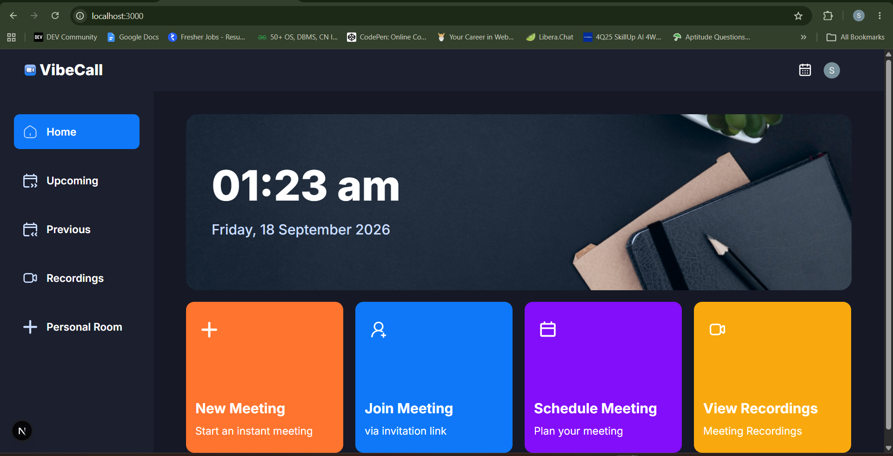
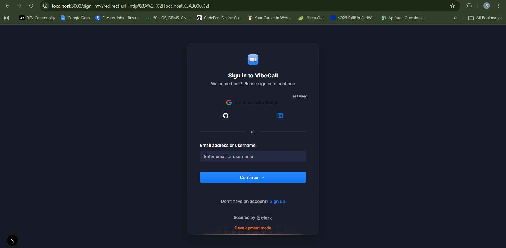
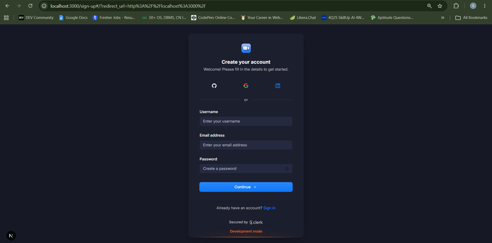
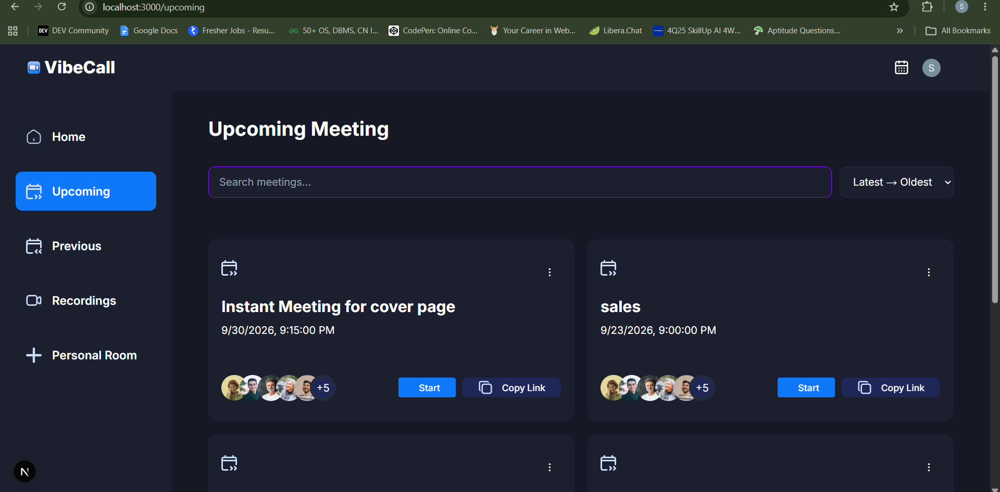
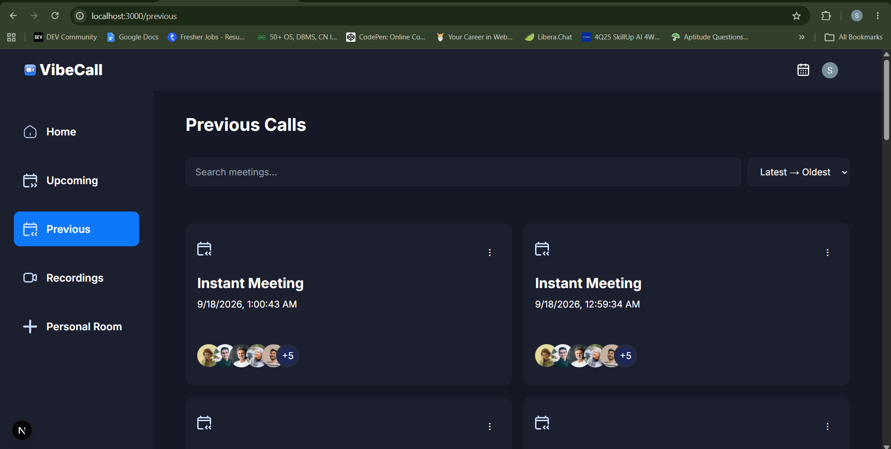
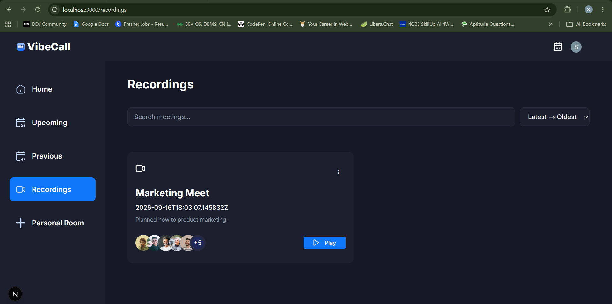
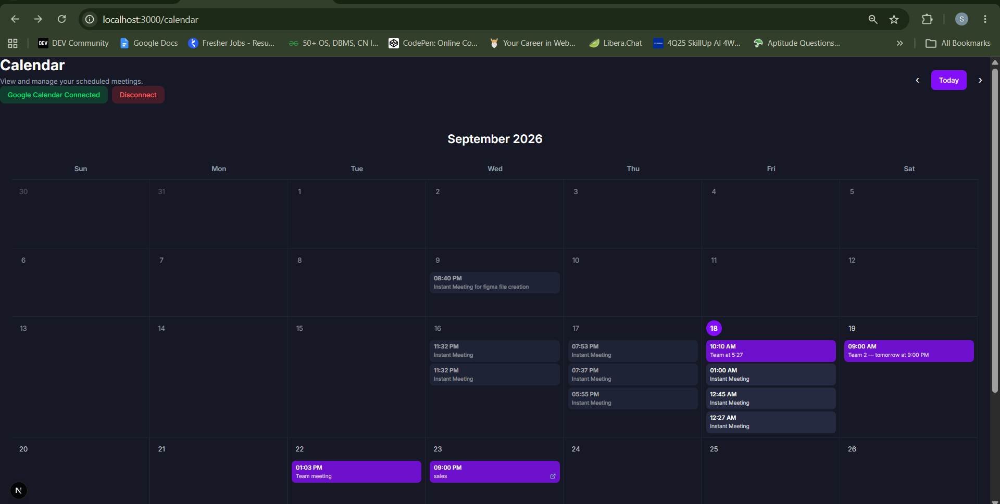
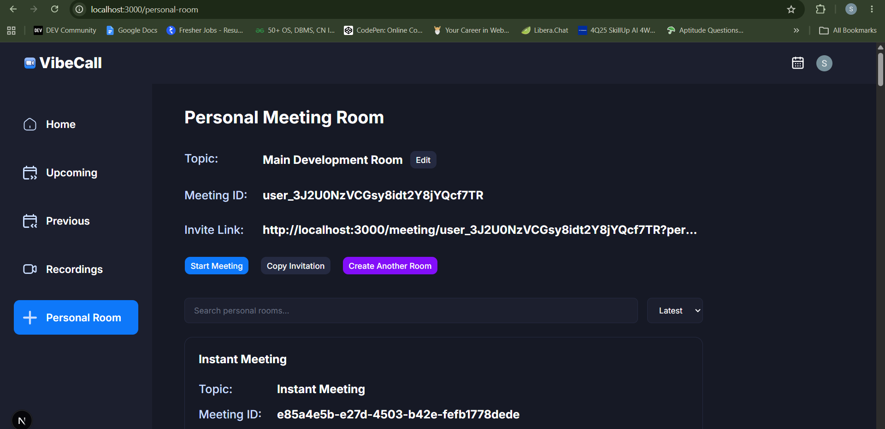

# VibeCall

> A full-stack real-time video conferencing platform built with Next.js, TypeScript, Clerk, and Stream.

VibeCall is a modern video conferencing application that enables users to **create, schedule, join, and manage online meetings**.

It provides real-time video and audio communication, screen sharing, meeting chat, recordings, participant management, waiting rooms, host controls, passcode-protected meetings, and multiple meeting layouts.

The project was built to explore **production-style real-time application development**, including authentication, real-time communication, asynchronous meeting state, permissions, protected meeting flows, and interactive user interfaces.

<p align="center">
  <a href="https://vibe-call-nine.vercel.app/">
    
  </a>
</p>

---

## Features

### Authentication & Access

* **User Authentication** — Secure sign-up and sign-in with Clerk
* **Protected Routes** — Authenticated access to meeting functionality
* **Meeting Passcodes** — Protect meetings with passcode verification
* **Waiting Room** — Participants wait for the host before entering a meeting

### Meeting Management

* **Create Meetings** — Start instant meetings with unique meeting rooms
* **Schedule Meetings** — Schedule meetings for a future date and time
* **Join Meetings** — Join meetings through unique meeting links
* **Personal Room** — Dedicated personal meeting room for each user
* **Meeting Sharing** — Share or copy the current meeting link
* **Upcoming Meetings** — View scheduled meetings
* **Previous Meetings** — Access previously completed meetings
* **Meeting Calendar** — View scheduled meetings in a calendar interface

### Real-Time Communication

* **Video & Audio** — Real-time communication powered by Stream Video
* **Screen Sharing** — Share your screen during meetings
* **Mute / Camera Controls** — Control microphone and camera state
* **Meeting Chat** — Real-time text messaging inside meetings
* **Participants Panel** — View participants currently in the meeting
* **Participant Count** — Display the current number of participants
* **Meeting Recordings** — Access recorded meetings
* **Call Statistics** — View real-time call statistics

### Host & Meeting Controls

* **Host Controls** — Meeting hosts can manage meeting participants and settings
* **Participant Permissions** — Manage participant access and meeting permissions
* **End Call for Everyone** — Meeting owners can terminate the meeting for all participants
* **Multiple Layouts** — Grid, speaker-left, and speaker-right layouts

### User Experience

* **Responsive UI** — Designed for different screen sizes
* **Interactive Meeting Interface** — Real-time controls and meeting state updates
* **Reusable Components** — Modular React components for meeting functionality

---

## Tech Stack

| Category                 | Technologies           |
| ------------------------ | ---------------------- |
| **Framework**            | Next.js                |
| **Language**             | TypeScript             |
| **Frontend**             | React                  |
| **Styling**              | Tailwind CSS           |
| **UI Components**        | shadcn/ui              |
| **Icons**                | Lucide React           |
| **Authentication**       | Clerk                  |
| **Video Infrastructure** | Stream Video SDK       |
| **Real-Time Chat**       | Stream Chat SDK        |
| **Backend**              | Next.js Server Actions |
| **Server SDK**           | Stream Node SDK        |
| **Development Tools**    | ESLint, Git, GitHub    |

---

## Application Architecture

VibeCall uses a client-server architecture where authentication, application state, meeting interfaces, and real-time communication are handled through dedicated application layers.

```text
                         ┌─────────────────────┐
                         │        User         │
                         └──────────┬──────────┘
                                    │
                                    ▼
                         ┌─────────────────────┐
                         │ Clerk Authentication│
                         └──────────┬──────────┘
                                    │
                                    ▼
                         ┌─────────────────────┐
                         │  VibeCall Dashboard │
                         └──────────┬──────────┘
                                    │
                 ┌──────────────────┼──────────────────┐
                 │                  │                  │
                 ▼                  ▼                  ▼
          Create Meeting      Schedule Meeting     Personal Room
                 │                  │                  │
                 └──────────────────┼──────────────────┘
                                    │
                                    ▼
                            ┌───────────────┐
                            │  Meeting Room │
                            └───────┬───────┘
                                    │
                   ┌────────────────┼────────────────┐
                   │                │                │
                   ▼                ▼                ▼
             Stream Video      Stream Chat      Meeting State
                   │                │                │
                   ├── Video        ├── Messages    ├── Lobby
                   ├── Audio        │                ├── Permissions
                   ├── Screen      │                ├── Host Controls
                   │   Sharing      │                └── Meeting Lifecycle
                   └── Recording    │
                                    │
                                    ▼
                              Participants
```

---

## Application Flow

```text
User
 │
 ▼
Clerk Authentication
 │
 ▼
VibeCall Dashboard
 │
 ├── Create Meeting
 │      └── Meeting Room
 │
 ├── Schedule Meeting
 │      └── Upcoming Meetings
 │
 ├── Personal Room
 │      └── Meeting Room
 │
 └── Join Meeting
        │
        ▼
   Passcode Verification
        │
        ▼
    Meeting Lobby
        │
        ▼
    Video Meeting
        │
        ├── Video / Audio
        ├── Screen Share
        ├── Participants
        ├── Meeting Chat
        ├── Recording
        ├── Call Statistics
        ├── Layout Controls
        └── Host Controls
```

---

## Screenshots

### Home



### Authentication

| Sign In                                                                                             | Sign Up                                                                                             |
| --------------------------------------------------------------------------------------------------- | --------------------------------------------------------------------------------------------------- |
|  |  |

### Meeting Management

| Upcoming Meetings                                                                                     | Previous Meetings                                                                                     |
| ----------------------------------------------------------------------------------------------------- | ----------------------------------------------------------------------------------------------------- |
|  |  |

| Meeting Recordings                                                                                       | Meeting Calendar                                                                                     |
| -------------------------------------------------------------------------------------------------------- | ---------------------------------------------------------------------------------------------------- |
|  |  |

### Personal Room



---

## Project Structure

```text
vibeCall/
├── actions/
│   └── stream.actions.ts
│
├── app/
│   ├── (auth)/
│   ├── (root)/
│   ├── api/
│   ├── globals.css
│   └── layout.tsx
│
├── components/
│   ├── MeetingChat.tsx
│   ├── MeetingLobby.tsx
│   ├── MeetingRoom.tsx
│   ├── MeetingSetup.tsx
│   ├── MeetingCard.tsx
│   ├── EndCallButton.tsx
│   └── ...
│
├── constants/
├── convex/
│
├── hooks/
│   ├── useGetCallById.ts
│   └── useGetCalls.ts
│
├── providers/
│   └── StreamClientProvider.tsx
│
├── lib/
│   └── utils.ts
│
├── public/
├── screenshots/
├── proxy.ts
├── package.json
└── README.md
```

---

## Getting Started

### Prerequisites

Make sure you have the following installed:

* Node.js
* npm
* Git
* A Clerk account
* A Stream account

### 1. Clone the repository

```bash
git clone https://github.com/shrutikotgire0129/vibeCall.git
```

### 2. Navigate to the project

```bash
cd vibeCall
```

### 3. Install dependencies

```bash
npm install
```

### 4. Configure environment variables

Create a `.env.local` file in the root directory:

```env
NEXT_PUBLIC_CLERK_PUBLISHABLE_KEY=
CLERK_SECRET_KEY=

NEXT_PUBLIC_STREAM_API_KEY=
STREAM_SECRET_KEY=
```

Add the appropriate values from your Clerk and Stream dashboards.

> **Security:** Never commit `.env.local` or any file containing secret credentials to GitHub.

### 5. Start the development server

```bash
npm run dev
```

Open:

```text
http://localhost:3000
```

---

## Production Build

Create an optimized production build:

```bash
npm run build
```

Start the production server:

```bash
npm start
```

---

## Environment & Security

VibeCall keeps sensitive credentials outside the source code using environment variables.

The repository excludes environment files through `.gitignore`:

```text
.env
.env.local
.env.*
```

Server-side Stream credentials are handled through server-side code rather than being exposed directly to the browser.

Authentication and protected application routes are handled through Clerk.

---

## Key Engineering Concepts

VibeCall was designed around several concepts commonly found in production real-time applications.

### Authentication

Clerk handles user authentication and provides protected access to the application's meeting functionality.

### Real-Time Communication

Stream Video provides the infrastructure for real-time audio and video communication, screen sharing, recording, participant management, and call statistics.

### Real-Time Messaging

Stream Chat enables participants to communicate through meeting-specific text chat.

### Meeting State

The application manages different meeting states throughout the meeting lifecycle:

```text
Scheduled
    ↓
Join / Start
    ↓
Passcode Verification
    ↓
Waiting Room
    ↓
Active Meeting
    ↓
Ended
```

### Permissions

Meeting functionality differentiates between hosts and participants, allowing the meeting owner to control access and terminate meetings when required.

### Server-Side Operations

Next.js Server Actions and the Stream Node SDK are used for server-side operations that require protected credentials.

---

## What I Learned

Building VibeCall provided hands-on experience with:

* Building a full-stack application with Next.js
* Developing reusable React and TypeScript components
* Implementing authentication with Clerk
* Integrating real-time video infrastructure
* Working with real-time messaging
* Managing asynchronous meeting state
* Handling host and participant permissions
* Implementing protected meeting flows
* Working with Next.js Server Actions
* Integrating client-side and server-side SDKs
* Designing responsive and interactive interfaces
* Structuring a larger Next.js application
* Managing environment variables and server-side secrets
* Building features around real-time user interactions

---

## Challenges

Some of the main engineering challenges involved:

* Managing real-time meeting state and participant interactions
* Designing a reliable meeting join and waiting-room flow
* Handling different permissions for hosts and participants
* Integrating video, audio, screen sharing, chat, and recordings into one interface
* Keeping sensitive Stream credentials on the server
* Maintaining reusable components across different meeting states
* Building a responsive interface for complex real-time meeting controls

---

## Future Improvements

Potential improvements for future versions include:

* Meeting notifications and reminders
* Advanced participant moderation
* Enhanced meeting analytics
* Improved recording management
* Calendar integrations
* More granular meeting permissions
* Additional accessibility improvements

---

## Author

**Shruti Hiraman Kotgire**

[](https://github.com/shrutikotgire0129)

[](https://www.linkedin.com/in/shrutikotgire129)

---

## License

This project is intended for learning and portfolio purposes.
